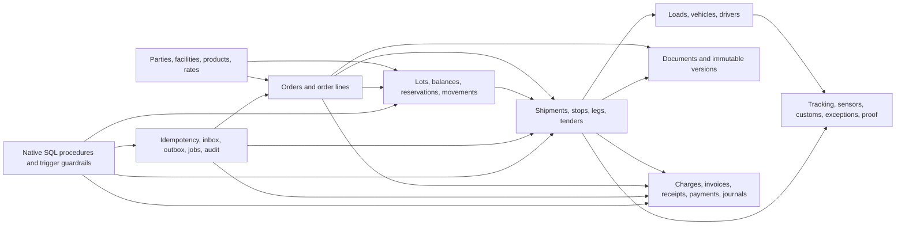

# Supply-chain logistics backend design

> **Status, 2026-10-10:** the generated DDL passes `tools/ddl.py lint`. The three
> self-referencing keys (F01803, F05604, F05804) are added by `ALTER TABLE` after
> their table's enforcing index, with `ON DELETE NO ACTION`: IBM allows only
> `CASCADE` or `NO ACTION` when parent and dependent are the same table. The script
> meets 11 of 43 `core` variety requirements because the request fixes one uniform
> logged PBG design for every table; use it for realistic topology and
> [varied-schema.sql](../../varied-schema.sql) for syntax variety. `plan.json` was
> regenerated from `request.json` with repository-relative paths.

## Use case

A multi-tenant third-party logistics company operates a shared control tower for
many shippers. It receives inbound, outbound, transfer, and return orders;
reserves stock across warehouses; builds multimodal shipments; tenders individual
legs to carriers; consolidates accepted legs into loads; records execution and
proof; bills customers; pays carriers; and publishes events to surrounding IT
systems.

The core scenario is an outbound customer order:

1. An external order is deduplicated and stored with stops and product lines.
2. Available lot-level stock is reserved. An append-only inventory movement
   records every receipt, move, issue, return, damage, or adjustment.
3. One order can feed many shipments, and one shipment can consolidate many
   orders. Shipment items retain the exact order-line and optional lot lineage.
4. A shipment is split into ordered stops and mode-specific legs. Tender attempts
   preserve each carrier offer and response. Accepted legs are assigned to loads,
   vehicles, and drivers with effective-dated history.
5. Appointments, tracking events, sensor readings, customs entries, delivery
   receipts, documents, and exception actions provide execution evidence.
6. Rated charges split into customer receivables and carrier payables. Separate
   invoice, cash-receipt, payment-allocation, and journal models prevent a carrier
   settlement from being mistaken for customer revenue.
7. The business change, audit row, and immutable outbox payload commit together.
   Delivery retries update a separate delivery-state row.
8. Native SQL procedures coordinate the multi-row commands. Triggers reject local
   invariant violations, maintain derived state, and add audit/outbox evidence in
   the caller's unit of work.

## Domain map

The physical DDL contains 68 base tables:

- Reference and commercial master data: `CURRENCY`, `COUNTRY`,
  `UNIT_OF_MEASURE`, `TRANSPORT_MODE`, `EQUIPMENT_TYPE`, `TENANT`,
  `BUSINESS_PARTY`, `ADDRESS`, `FACILITY`, `FACILITY_DOCK`,
  `CUSTOMER_ACCOUNT`, `CARRIER`, `SERVICE_LEVEL`, `PRODUCT`, `LANE`,
  `RATE_CONTRACT`, and `RATE_RULE`.
- Warehouse and orders: `STORAGE_LOCATION`, `INVENTORY_LOT`,
  `INVENTORY_BALANCE`, `FULFILLMENT_ORDER`, `ORDER_STOP`, `ORDER_LINE`,
  `INVENTORY_RESERVATION`, and `INVENTORY_MOVEMENT`.
- Transportation and execution: `SHIPMENT`, `SHIPMENT_ORDER`,
  `SHIPMENT_ITEM`, `SHIPMENT_STOP`, `SHIPMENT_LEG`, `CARRIER_TENDER`,
  `TRANSPORT_LOAD`, `LOAD_LEG`, `VEHICLE`, `DRIVER`, `LOAD_VEHICLE`,
  `LOAD_DRIVER`, `APPOINTMENT`, `TRACKING_EVENT`, `SENSOR_READING`,
  `DELIVERY_RECEIPT`, `CUSTOMS_ENTRY`, `EXCEPTION_CASE`, and
  `EXCEPTION_ACTION`.
- Documents: `DOCUMENT`, `DOCUMENT_VERSION`, `DOCUMENT_CONTENT`,
  `SHIPMENT_DOCUMENT`, and `ORDER_DOCUMENT`.
- Billing and accounting: `CHARGE`, `CUSTOMER_INVOICE`,
  `CUSTOMER_INVOICE_LINE`, `CARRIER_INVOICE`, `CARRIER_INVOICE_LINE`,
  `CASH_RECEIPT`, `RECEIPT_ALLOCATION`, `CARRIER_PAYMENT`,
  `PAYMENT_ALLOCATION`, `ACCOUNTING_PERIOD`, `GL_ACCOUNT`, `JOURNAL`, and
  `JOURNAL_LINE`.
- Backend operations: `IDEMPOTENCY_REQUEST`, `INBOUND_MESSAGE`,
  `OUTBOX_EVENT`, `OUTBOX_DELIVERY`, `BATCH_JOB_RUN`, and `AUDIT_EVENT`.

## Trigger and procedure mix

The design adds 8 triggers and 8 native SQL procedures around the 68 base
tables. Procedures own multi-row business commands. Triggers stay narrow: they
protect row transitions, maintain derived state, or create evidence that must
commit with the triggering change. Services still authenticate the tenant,
authorize the operation, choose retry policy, and translate Db2 diagnostics.

**Current artifact boundary:** the generator and its output are still
table/index-only. The routine inventory below is design scope until matching
DDL, case metadata, catalog assertions, and generator tests are added.

### Triggers

- `TR_BI_INV_MOVEMENT` is a basic `NO CASCADE BEFORE INSERT` trigger. It rejects
  invalid source/destination shapes before an inventory movement is accepted.
- `TR_AI_INV_MOVEMENT` is an advanced `AFTER INSERT` trigger. It applies the
  movement to `INVENTORY_BALANCE`, increments `VERSION_NO`, and writes the
  corresponding `AUDIT_EVENT` and `OUTBOX_EVENT` rows.
- `TR_BU_INV_BALANCE` is a basic `NO CASCADE BEFORE UPDATE` trigger. It prevents
  a caller from lowering or skipping the next balance version. The update must
  still predicate on the old `VERSION_NO` to detect concurrent writers.
- `TR_BU_TENDER` and `TR_AU_TENDER` guard the legal carrier-tender transition
  and publish accepted-tender evidence after the transition succeeds.
- `TR_BU_JOURNAL` is an advanced `BEFORE UPDATE OF STATUS` trigger. A transition
  to posted is rejected unless the accounting period is open and total debits
  equal total credits.
- `TR_BU_OUTBOX_EVENT` and `TR_BD_OUTBOX_EVENT` reject changes to, or deletion
  of, an immutable outbox payload. Delivery attempts remain mutable only through
  `OUTBOX_DELIVERY`.

Use basic triggers with required `MODE DB2SQL` for the focused `SET` or `SIGNAL`
bodies. Use advanced triggers, without `MODE DB2SQL`, only where SQL PL variables,
queries, or multi-step actions are required. The initial mix has at most one
trigger for each subject/event/activation-time combination, so correctness does
not depend on creation-timestamp activation order. None of the bodies commits,
calls an autonomous routine, or starts an uncontrolled trigger cascade.

### Native SQL procedures

- `RESERVE_INVENTORY` and `RELEASE_INVENTORY` lock or version-check the balance,
  write the reservation and compensating movement, and rely on the movement
  trigger for the derived balance and evidence rows.
- `ACCEPT_CARRIER_TENDER` and `ASSIGN_LOAD_RESOURCES` serialize the active-plan
  checks and preserve load, vehicle, and driver assignment history.
- `POST_CUSTOMER_INVOICE` and `POST_CARRIER_PAYMENT` verify currency and open
  amounts before creating immutable allocation rows.
- `POST_JOURNAL` validates the open period and requests the guarded transition
  from draft to posted. The trigger remains the final database-side backstop.
- `CLAIM_OUTBOX_DELIVERIES` claims a bounded retry batch and returns the claimed
  rows to a dispatcher without changing the immutable event payload.

Define these as versioned native SQL procedures with `VERSION V1`, `LANGUAGE SQL`,
matching `SPECIFIC` names, explicit SQL-data-access declarations,
`PARAMETER CCSID UNICODE`, `COMMIT ON RETURN NO`, `DISABLE DEBUG MODE`, and the
reviewed package `APPLCOMPAT`. The caller owns commit or rollback. Command
procedures accept `TENANT_ID` plus an idempotency key and never infer tenant
context from a globally unique identifier.

## First-principles decisions

### Tenant isolation is relational

Every tenant-owned primary and alternate key begins with `TENANT_ID`. Every
foreign key between tenant-owned tables carries the same prefix on both sides.
Global identifiers alone do not stop a row owned by tenant A from referencing a
valid object owned by tenant B; composite tenant keys do.

Services must still authorize tenant context and include it in every predicate.
The keys defend data integrity, not application authorization.

### Plans, execution, and financial truth are separate

An order expresses demand. A shipment expresses a movement plan. Legs express
route segments. A load expresses carrier execution. Their many-to-many link rows
allow consolidation, splitting, re-tendering, and re-assignment without rewriting
the original customer order.

Likewise, a charge is rated operational economics, an invoice is a legal payable
or receivable, a cash/payment row is settlement, and a journal is accounting.
Keeping them separate makes disputes, partial allocations, reversals, and period
close explicit.

### History uses movements or immutable evidence

Inventory, tracking, sensor, exception-action, document-version, allocation,
outbox-payload, and audit rows are append-oriented. Corrections use new
compensating rows. Mutable current-state rows such as inventory balances are
rebuildable optimizations and carry a `VERSION_NO` concurrency token.

Stateful workflow rows, including tenders, loads, invoices, outbox delivery, and
jobs, can change until terminal status. The application must reject illegal state
transitions and mutation after terminal status; a row `CHECK` cannot compare old
and new values.

### Units, currency, and time are explicit

Quantities name a unit of measure. Monetary rows name a currency and use exact
decimals. Rates use more scale than posted money. Business timestamps are stored
in UTC; address/facility time-zone names support local appointment display and
conversion. No implicit unit or currency conversion is allowed.

### Integration failure is normal

`IDEMPOTENCY_REQUEST` deduplicates API commands by tenant, service, and key.
`INBOUND_MESSAGE` deduplicates external messages by source identity.
`OUTBOX_EVENT` stores the immutable event in the same transaction as the business
change, while `OUTBOX_DELIVERY` tracks retries independently. `BATCH_JOB_RUN`
provides restart checkpoints and operational evidence.

## Transactions the procedures and service layer must enforce

DDL constraints handle identity, tenant containment, parent existence, basic
ranges, and simple state shapes. Procedures provide the database-side command
boundary, while the service layer still owns authorization and orchestration.
Together they must atomically enforce:

- reservation and shipment quantities do not exceed open order demand or
  available stock;
- one active load/vehicle/driver assignment exists where the operating model
  requires it, with no impossible time overlap;
- stop and leg status follows a legal transition graph, and current status agrees
  with immutable tracking evidence;
- tender acceptance is unique for the active plan, and the accepted carrier
  matches the load and its resources;
- customer and carrier invoice currency matches every allocated charge;
- cash and payment allocations do not exceed settled funds or open invoice value;
- journal posting occurs in an open period and total debits equal total credits;
- business change, audit evidence, and outbox event commit in one unit of work;
- document length and SHA-256 digest match the BLOB written in the same unit of
  work, while retention and legal holds prevent operational deletion.

## Physical design and deployment boundary

The generated DDL uses one application database, `SCLDB`, and schema
`LOGISTICS`. It creates one explicit logged PBG universal table space per ordinary
table. `DOCUMENT_CONTENT` deliberately uses an implicit base table space so Db2
also creates the required LOB support objects inside `SCLDB`.

Deploy tables and enforcing indexes first, native SQL procedures second, and
triggers last. Routine bodies contain embedded semicolons, so the routine phase
must use a distinct outer terminator such as `@`; the SQL processor must preserve
body comments, line breaks, case, and literal whitespace.

Database extraction alone might not include schema-level procedures. Product
verification must explicitly extract the database dependents plus the 8 procedure
definitions, then replay tables/indexes, procedures, and triggers in that order
under clean names and validate the implicitly bound packages. Compare
`SYSTRIGGERS`, `SYSTRIGGERS_STMT`, `SYSROUTINES`, `SYSPARMS`, `SYSPACKAGE`,
`SYSPACKDEP`, and `SYSENVIRONMENT`, and run behavioral probes for transition
rejection, atomic rollback, balance updates, posting, and outbox claiming. Cleanup
must explicitly drop the procedures; dropping `SCLDB` is not sufficient cleanup
for schema-level routines.

Reference tables start at 1 partition x 1 GB, core master tables at 16 x 4 GB,
and high-growth tables at 64 x 4 GB. These are reviewable growth ceilings. Real
volume, retention, recovery objectives, utilities, and access paths may justify
PBR table spaces, separate buffer pools/databases, compression, or fewer indexes.

Before execution, replace or confirm `SYSDEFLT` and `BP0`; record the real Db2 13
function level, package `APPLCOMPAT`, `CURRENT RULES`, subsystem defaults, SMS
capabilities, active buffer pools, and privileges. The repository checks are
static and do not prove prepare or execution on Db2. For advanced triggers, record
both the application compatibility used to process the definition and the body
package `APPLCOMPAT`.

## Deliberately excluded

This foundation does not implement route optimization, real-time geospatial
search, tariff classification detail, hazmat regulation engines, labor management,
yard topology, demand forecasting, EDI payload archives, identity-provider
credentials, tax engines, currency conversion, or analytics/star schemas. Those
belong in bounded extensions after their workloads, retention, and authority
models are known.

## Artifacts and sources

- DDL: run `python3 examples/domains/supply-chain-logistics/generate.py`; it writes
  `generated/supply-chain-logistics/source.sql` (ignored by git)
- Reproducible generator: [`generate.py`](generate.py)
- Structured request: [`request.json`](request.json)
- Planner evidence: [`plan.json`](plan.json)
- Design case: [`case.json`](case.json)

Table syntax and physical choices were checked against the repository's normalized
IBM-source records and official Db2 13 sources. The routine design uses the same
source baseline, but each concrete body must be reviewed again when its DDL is
authored: the [Db2 13 SQL Reference](https://www.ibm.com/docs/en/SSEPEK_13.0.0/pdf/db2z_13_sqlrefbook.pdf),
[PBG table-space guidance](https://www.ibm.com/docs/en/db2-for-zos/13.0.0?topic=spaces-creating-partition-by-growth-table),
the [LOB support-object guidance](https://www.ibm.com/docs/en/db2-for-zos/13.0.0?topic=its-creating-lob-table-spaces-auxiliary-tables-auxiliary-indexes-explicitly),
the [basic trigger statement](https://www.ibm.com/docs/en/db2-for-zos/13.0.0?topic=statements-create-trigger-basic),
the [advanced trigger statement](https://www.ibm.com/docs/en/db2-for-zos/13.0.0?topic=statements-create-trigger-advanced),
and the [native SQL procedure statement](https://www.ibm.com/docs/en/db2-for-zos/13.0.0?topic=statements-create-procedure-sql-native).
